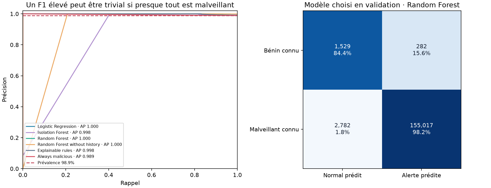
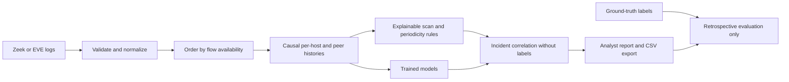

# Network Watch

[](https://github.com/thezanis11/network-watch/actions/workflows/checks.yml)

Repository: [thezanis11/network-watch](https://github.com/thezanis11/network-watch).

**From real network logs to reproducible intrusion detection and correlated incidents.**

Network security · Zeek · Suricata EVE · causal features · machine learning · incident analysis

Network Watch is an offline analytics pipeline for completed network flows. It parses Zeek ASCII/JSON and Suricata EVE flow/alert records, extracts features available at observation time, compares explainable rules and trained detectors, then correlates alerts into incidents with traceable evidence.



## What has actually been executed

- Downloaded the original **CTU-IDSEVAL-6** labeled Zeek logs, documentation and label rules, with checksum verification. No malware executables or packet payloads are needed.
- Parsed all six captures. The source logs contain **286,702 rows**, two fewer than the number declared in the authors' README; the discrepancy is recorded, not silently filled.
- Applied a fixed capture split and chronological benign-data partitions with 300-second purges, leaving **286,130 observed flows**.
- Trained Logistic Regression, normal-only Isolation Forest and Random Forest; compared a forest without history, explainable rules and constant prediction baselines.
- Evaluated separate malware and scan captures, generated flow scores, **141 correlated incidents** and label-derived reference episodes.
- Tested adapters, label exclusion, temporal causality, purge gaps, correlation independence and imbalance diagnostics.

Read the [standalone report](reports/index.html), [results summary](reports/RESULTS_FR.md), [methodology](docs/METHOD.md), [source quality audit](reports/data_quality.json), and [French learning guide](docs/GUIDE_FR.md).

GitHub displays Markdown and figures. Download the repository ZIP and open `reports/index.html` locally for the interactive incident filter. No server is required.

## Findings worth discussing

The validation-selected Random Forest achieved test F1 **0.990**, balanced accuracy **0.913**, MCC **0.540**, and a known-benign false-positive rate of **15.57%**. Malware-capture recall was **89.57%**; scan recall was approximately **100%**. These are research results, not production protection guarantees.

**The test is heavily attack-dominated.** Predicting every flow as malicious already achieves F1 **0.994**, but balanced accuracy 0.5 and MCC 0. The report therefore includes trivial baselines, class-normalized confusion counts and per-capture results instead of promoting a single high F1. The forest without history performs better on this test, although it was not selected by validation: added sophistication is not assumed to improve generalization.

Unknown/background traffic is retained in the observation history and incident audit, but excluded from binary metrics. It is never relabeled as benign. Incident grouping does not consult labels; retrospective labels are attached only for evaluation. Reference episodes are derived from labels, not independently annotated analyst incidents.

## Reproduce — Windows PowerShell

```powershell
python -m venv .venv
.\.venv\Scripts\python.exe -m pip install -r requirements-lock.txt
.\.venv\Scripts\python.exe scripts/download_data.py
.\.venv\Scripts\python.exe scripts/audit_data.py
.\.venv\Scripts\python.exe -m network_watch.cli benchmark
.\.venv\Scripts\python.exe -m unittest discover -s tests -v
```

On Linux/macOS replace `.\.venv\Scripts\python.exe` with `.venv/bin/python`. Python 3.14 was used for measured runs. No GPU, live network access, sensor deployment or database server is required. Internet is needed for dependencies and the approximately 8 MB original text-log download. Preparation and training run locally; recipe-specific feature caches avoid repeating extraction unnecessarily.

Replay a real held-out malware capture:

```powershell
.\.venv\Scripts\python.exe scripts/replay_demo.py
```

Analyze another supported local file:

```powershell
.\.venv\Scripts\python.exe -m network_watch.cli analyze path/to/conn.log --format zeek --out reports/my-incidents.csv
.\.venv\Scripts\python.exe -m network_watch.cli analyze path/to/eve.json --format eve --out reports/my-eve-incidents.csv
```

Suricata adapter support is fixture-tested. No Suricata deployment or cross-format accuracy benchmark is claimed. EVE alert and end-of-flow records can describe the same connection; combining both is not complete flow deduplication. Models trained on CTU traffic can behave differently on another environment.

## Architecture and observation time



A Zeek connection's duration and byte totals are not available at its first packet. This prototype approximates observation time by `start + duration`, sorts accordingly, and uses only earlier completed-flow observations. Flow-completion latency remains a limitation. Addresses, UID, capture names, labels and absolute dates never enter the model matrix.

The 60-second per-source history tracks connection volume, port/destination diversity, failures and byte asymmetry. A bounded peer history measures interarrival regularity. Rules provide behavioral evidence; a model score is not a calibrated probability of an incident.

## Output files

- `reports/experiment.json`: split membership, inventory, feature recipe hash, thresholds and all model metrics.
- `reports/test_predictions.csv.gz`: compressed per-flow test scores; plain CSV and processed data remain local.
- `reports/incidents.csv`: operational groups with retrospective statuses and deterministic host pseudonyms.
- `reports/reference_episodes.json`: label-derived detection episodes and delays.
- `reports/data_quality.json`: source counts, duplicate UID checks and purge accounting.
- `models/`: local trained artifacts, excluded from Git; reproduce them with the benchmark. Load only trusted model artifacts.

## Limits and attribution

This is an exploratory study: test metrics were inspected during evaluation development. The model recipe and split are fixed, but this is not an independent blind audit. One held-out malware capture and one very large scan limit generalization; treating correlated flows as independent trials would exaggerate confidence. A single benign recording has temporal partitions rather than independent captures. The reported episode delay starts at flow availability, not attack onset.

Code: [MIT](LICENSE). Data: **CC BY 4.0** according to the official record. Cite Garcia, Valeros and Alya, [CTU-IDSEVAL-6](https://doi.org/10.5281/zenodo.21027042), Stratosphere Laboratory, 2026. Schema references: [Zeek conn.log](https://docs.zeek.org/en/current/logs/conn.html) and [Suricata EVE](https://docs.suricata.io/en/latest/output/eve/eve-json-output.html).

Developed with AI assistance. See the learning guide for the concepts to explain and improvements to implement personally before presenting the project in an interview.
